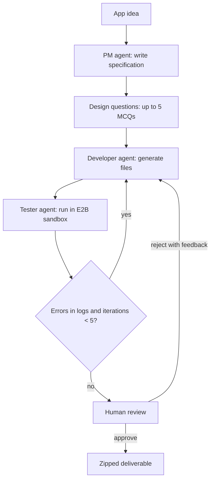

# Automaton Boardroom

A multi-agent software micro-agency built with LangGraph. Describe an application in plain language; the system writes a specification, asks a few build-decision questions, generates the code, runs it in an isolated E2B sandbox, fixes failures automatically, and waits for human approval before delivering a zipped project.

## Contents

- [Features](#features)
- [How it works](#how-it-works)
- [Requirements](#requirements)
- [Installation](#installation)
- [Configuration](#configuration)
- [Running the app](#running-the-app)
- [Deployment](#deployment)
- [Project structure](#project-structure)
- [Development](#development)
- [Troubleshooting](#troubleshooting)
- [Limitations](#limitations)
- [License](#license)

## Features

- **Full development lifecycle**: specification, design decisions, code generation, sandboxed testing, self-correction, and human review.
- **Build-decision questions**: up to 5 single-choice questions about scope and architecture are asked before coding, and the answers constrain the generated code.
- **Self-correction**: test or runtime failures are fed back to the developer agent, for up to 5 iterations.
- **Isolated execution**: generated code runs in an [E2B](https://e2b.dev) cloud sandbox, not on the host.
- **Stack-aware generation**: plain Python scripts, FastAPI, Django, React (Vite), and full-stack FastAPI + React projects each get stack-specific guidance.
- **Prompt-injection guards**: user input and LLM output are sanitized, length-capped, and validated before use.
- **Human-in-the-loop**: approve the result or reject it with a reason that is sent back to the developer agent.
- **Observability**: agent nodes are instrumented with LangSmith `@traceable` for optional tracing.
- **Two interfaces**: a Streamlit web UI (`app.py`) and a command-line runner (`main.py`).

## How it works



| Agent | Responsibility |
|-------|----------------|
| PM | Turns the idea into a specification and file plan. |
| Design questions | Asks up to 5 single-choice questions (2 to 6 options each) about material decisions. Answers are passed to the developer. |
| Developer | Writes the project files, including a Dockerfile and `docker-compose.yml` where applicable. Fixes issues from test logs and human feedback. |
| Tester | Detects the stack, installs dependencies, starts servers or runs scripts and builds in an E2B sandbox, and captures logs. |
| Human review | Pauses the graph until a reviewer approves or rejects the output. |

The graph is defined in [agency/graph.py](agency/graph.py). Routing after the tester uses keyword matching on the test logs (for example `Error`, `FAILED`, `ModuleNotFoundError`, `npm ERR`). Any match loops back to the developer while the iteration count is below 5.

## Requirements

- Python 3.10 or later. The project pins Python 3.12 in `.python-version`.
- [uv](https://docs.astral.sh/uv/) for dependency management.
- A Google Gemini API key from [Google AI Studio](https://aistudio.google.com/apikey).
- An E2B API key from [e2b.dev](https://e2b.dev).
- Optional: a LangSmith API key for tracing.

All of these services offer free tiers with quotas. Check each provider's current limits before relying on them.

## Installation

```bash
git clone https://github.com/prashant33/automaton-boardroom.git
cd automaton-boardroom

uv sync
```

`uv sync` creates `.venv/` and installs the locked dependencies from `uv.lock`.

## Configuration

Copy the template and fill in your keys:

```bash
cp .env.example .env
```

| Variable | Required | Description |
|----------|----------|-------------|
| `GOOGLE_API_KEY` | Yes | Gemini API key. Used when no per-session key is entered in the UI. |
| `GEMINI_MODEL` | No | Model name. Defaults to `gemini-3.6-flash`. |
| `E2B_API_KEY` | Yes | E2B sandbox API key. |
| `LANGCHAIN_TRACING_V2` | No | Set to `true` to enable LangSmith tracing. |
| `LANGCHAIN_API_KEY` | No | LangSmith API key, required when tracing is enabled. |
| `LANGCHAIN_PROJECT` | No | LangSmith project name for grouping traces. |

Never commit `.env`. It is listed in `.gitignore`.

In the Streamlit UI, users can also enter their own Gemini key in the sidebar. The key is kept in the browser session only, is not written to disk or to `os.environ`, and is removed when the user clicks **Remove key**. When no session key is set, the server's `GOOGLE_API_KEY` is used.

## Running the app

### Web UI

```bash
uv run streamlit run app.py
```

Open `http://localhost:8501`. To use another port:

```bash
uv run streamlit run app.py --server.port 8502
```

### Command line

```bash
uv run python main.py
```

The CLI prompts for an app idea, asks each design question in the terminal, and prints the generated code and test logs for approval.

## Deployment

The app can be deployed to [Streamlit Community Cloud](https://share.streamlit.io/) without a separate server.

1. Push the repository to GitHub. Keep `.env` local.
2. In Streamlit Community Cloud, select **Create app**, choose this repository and the `main` branch, and set the main file path to `app.py`.
3. Under **Advanced settings**, choose Python 3.12 and add the secrets in TOML format:

   ```toml
   GOOGLE_API_KEY = "your_gemini_api_key"
   GEMINI_MODEL = "gemini-3.6-flash"
   E2B_API_KEY = "your_e2b_api_key"

   # Optional
   LANGCHAIN_TRACING_V2 = "false"
   LANGCHAIN_API_KEY = "your_langsmith_api_key"
   LANGCHAIN_PROJECT = "automaton-boardroom"
   ```

`app.py` copies top-level secrets into the environment at startup, so hosted and local configuration use the same variable names.

Restart the app after changing secrets.

### Hosting limitations

The workflow state is held by LangGraph's in-memory `MemorySaver`. Active runs are lost when the process restarts and are not shared between instances or users. Multi-user production hosting would need a persistent checkpointer, authentication, rate limiting, and monitoring.

## Project structure

```
automaton-boardroom/
├── app.py                      # Streamlit UI entry point
├── main.py                     # Command-line entry point
├── agency/
│   ├── graph.py                # LangGraph workflow, routing, and checkpointer
│   ├── nodes.py                # PM, design questions, developer, tester, and human nodes; Gemini client wrapper
│   ├── sandbox_runners.py      # E2B execution for Python, FastAPI, Django, React, and full-stack projects
│   ├── guards.py               # Prompt-injection sanitization and design-question validation
│   └── states.py               # Shared AgencyState definition
├── scripts/
│   └── manual_smoke_test_react.py   # Manual end-to-end check for the React pipeline
├── tests/                      # Pytest unit tests
├── pyproject.toml              # Project metadata, dependencies, and tool configuration
├── uv.lock                     # Locked dependency versions
├── .python-version             # Python version used for development and deployment
└── .env.example                # Environment variable template
```

## Development

Install the development extras:

```bash
uv sync --extra dev
```

Common commands:

```bash
# Run the test suite (coverage is enabled by default in pyproject.toml)
uv run pytest

# Lint, format, and type-check
uv run ruff check .
uv run black .
uv run isort .
uv run mypy agency/
```

The unit tests replace the Gemini client and LangGraph interrupts with fakes, so they do not make network calls.

## Troubleshooting

| Symptom | Resolution |
|---------|------------|
| `uv: command not found` | Install uv from [docs.astral.sh/uv](https://docs.astral.sh/uv/#installation). |
| `ModuleNotFoundError` for a project dependency | Run `uv sync` from the repository root. |
| Port 8501 already in use | Start on another port: `uv run streamlit run app.py --server.port 8502`. |
| `GOOGLE_API_KEY` not set | Add it to `.env`, or enter a key in the sidebar of the UI. |
| `Gemini quota exceeded` | The Gemini key has hit a per-minute or per-day limit. Wait, switch `GEMINI_MODEL`, or use a different key. |
| `Gemini failed: ...` | Check the key, the model name, and network access. The error is shown in the UI. |
| E2B authentication or quota error | Verify `E2B_API_KEY` and check the usage dashboard at e2b.dev. |
| `npm run build` fails with a timeout | The React build step has a 600-second limit. Reduce the project size or dependencies. |
| No traces appear in LangSmith | Set `LANGCHAIN_TRACING_V2=true` and provide a valid `LANGCHAIN_API_KEY`. |

## Limitations

- Generated projects are tested for startup and build success and for errors in the logs. They are not verified against the full specification.
- Self-correction is capped at 5 developer iterations. Problems that remain after that go to human review.
- Routing relies on keyword matching in the test logs, so a false positive or a missed error can change the routing.
- Workflow state is in memory and is lost when the process restarts.

## Contributing

Issues and pull requests are welcome. Before opening a pull request, run `uv run pytest` and the lint commands above, and keep changes focused on a single concern.

## License

Distributed under the MIT License, as declared in `pyproject.toml`.
